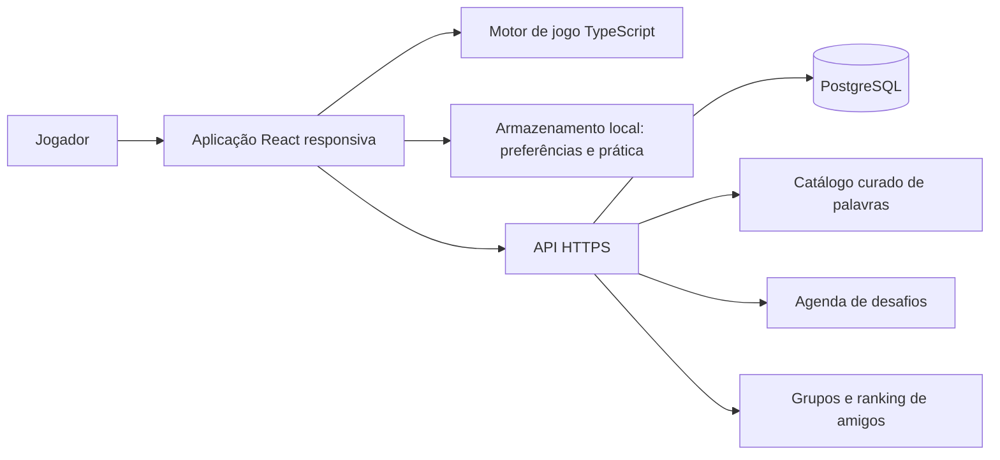

# Projeto Técnico — Jogo de Palavras

**Versão:** 0.1  
**Estado:** MVP local implementado; versão online planejada  
**Direção visual:** Gráfica de Bolso  
**Plataforma:** web responsiva, PT-BR

## 1. Objetivo

Este documento descreve uma arquitetura implementável para o jogo casual de adivinhação de palavras definido no PRD. A interface toma como referência o conceito **Gráfica de Bolso**: papel claro, tinta escura, acentos de cor inspirados em impressão e foco no tabuleiro. A página `mockups.html` é um protótipo de interação visual; ela não é a aplicação final e ainda não persiste dados nem implementa serviços online.

O MVP foi implementado com React, TypeScript e Vite, sem backend. As tabelas abaixo distinguem as partes já existentes das propostas para a versão online. O catálogo local é curado para demonstração acadêmica e deve ser ampliado/revisado antes de uso contínuo.

## 2. Decisões e premissas

| Área | Decisão proposta |
|---|---|
| Público e idioma | Público geral, português brasileiro (`pt-BR`). |
| Plataforma | Aplicação web responsiva, operável por mouse, toque e teclado. |
| Partidas | Desafio diário e prática livre, com progresso separado. |
| Mecânicas | Palpite por letras como modo principal; palavra por definição como modo alternativo. |
| Níveis iniciais | Leve: 4 letras/7 tentativas; Normal: 5/6; Desafiador: 7/5. Validar os parâmetros em teste com jogadores. |
| Feedback | Letra correta na posição, presente em outra posição ou ausente. A informação não depende só de cor. |
| Vocabulário | Lista de respostas curada separada da lista de palpites aceitos; acentos normalizados na comparação. |
| Aprendizado | Ao concluir, mostrar a grafia oficial, definição e exemplo de uso. |
| Social | Compartilhamento sem spoiler e ranking privado entre amigos, sem cronômetro. |
| Progressão | Estatísticas pessoais e coleção sem vantagens de jogo. |
| Sustentação | Gratuito e sem anúncios no escopo inicial. |

**Regra sugerida para o ranking:** comparar apenas resultados do mesmo desafio, modo e nível. Ordenar por tentativas usadas; empates compartilham a posição. Não usar tempo como desempate. Partidas incompletas não recebem colocação. Assim, um nível fácil não compete diretamente com um nível difícil.

**Premissa para o modo por definição:** no primeiro lançamento, ele usa o mesmo mecanismo de palpites e feedback de letras, mas apresenta uma definição curta desde o início. Isso mantém um único motor de jogo e adiciona contexto de vocabulário. Se o objetivo for um jogo de definição sem feedback posicional, essa regra precisa ser alterada antes da implementação.

## 3. Escopo por versão

### MVP local implementado

- Jogo no navegador implementado com dados locais de demonstração.
- Desafio diário, prática, dois modos e três níveis incluídos.
- Estatísticas, coleção e partidas persistidas neste dispositivo.
- Grade sem resposta copiável para a área de transferência.
- Ranking entre amigos apresentado como interface demonstrativa local.
- O ranking local não é tratado como ranking online confiável.

### Versão online

- Usar API e banco de dados para distribuir o mesmo desafio aos jogadores.
- Validar palpites e resultados diários no servidor.
- Criar grupos privados de amigos por convite e manter suas classificações.
- Permitir perfil convidado com apelido; não exigir e-mail no fluxo de jogo.

A separação é importante: um ranking entre dispositivos não pode ser correto ou resistente a alterações se depender exclusivamente de `localStorage` ou de respostas calculadas no cliente.

## 4. Arquitetura proposta

### Tecnologias

| Camada | Estado e tecnologia | Responsabilidade |
|---|---|---|
| Frontend | Implementado: React, TypeScript e Vite | Interface e navegação sem recarregamento. |
| Estilos | Implementado: CSS próprio e variáveis de design | Identidade visual e responsividade. |
| Tipografia | Implementado: Fontsource empacotado localmente | Evita chamadas de fontes a terceiros no runtime. |
| Motor de jogo | Implementado: módulo TypeScript puro | Normalização, validação, feedback, tentativas e resultado. |
| Persistência | Implementado: `localStorage` versionado | Partidas, estatísticas, coleção e preferências neste dispositivo. |
| Testes | Implementado: Vitest; Playwright usado para validação manual | Regras do motor, catálogo e restauração de progresso. |
| Backend online | Planejado: Node.js, TypeScript e Fastify | Desafio autoritativo, perfis convidados, grupos e ranking sincronizado. |
| Banco online | Planejado: PostgreSQL | Vocabulário, agenda, perfis, grupos e resultados. |

Dependências e scripts estão declarados em `package.json`; o projeto requer Node.js 20 ou superior. `mockups.html` permanece como galeria independente de conceitos e não é necessário para executar o aplicativo React.

### Diagrama lógico



No protótipo acadêmico, a aplicação pode usar um catálogo JSON versionado no repositório e não chamar a API. Na versão online, o servidor é a fonte de verdade para o desafio diário e para os resultados usados em rankings.

### Organização alvo para expansão online

O MVP atual usa `src/App.tsx`, `src/content.ts`, `src/game-core.ts`, `src/progress.ts` e arquivos de teste correspondentes. A estrutura abaixo é uma proposta futura caso a aplicação cresça para módulos de API, grupos e componentes compartilhados; ela ainda não foi criada.

```text
src/
  app/
    App.tsx
    routes.tsx
  components/
    Button.tsx
    SegmentedControl.tsx
    Dialog.tsx
  features/
    game/
      GameScreen.tsx
      GameBoard.tsx
      VirtualKeyboard.tsx
      GuessForm.tsx
      DefinitionClue.tsx
      ShareResult.tsx
    progress/
      StatisticsPanel.tsx
      CollectionPanel.tsx
    friends/
      FriendGroup.tsx
      Leaderboard.tsx
  game-core/
    normalize.ts
    evaluateGuess.ts
    rules.ts
    types.ts
  content/
    words.pt-BR.json
    daily-schedule.demo.json
  services/
    api.ts
    local-progress.ts
  styles/
    tokens.css
    global.css
    game.css
  test/
```

O motor não deve importar React, DOM, CSS, `localStorage` ou cliente HTTP. Isso permite testar as regras sem renderizar a interface e reutilizar a mesma lógica na prática local.

## 5. Interface e design system

### Tokens iniciais

| Token | Valor | Uso |
|---|---|---|
| Tinta | `#182522` | Texto principal e elementos escuros. |
| Papel | `#F4F0E5` | Superfície principal. |
| Papel secundário | `#E8E1D1` | Pistas, controles e estados suaves. |
| Goiaba | `#B74334` | Ação primária e destaque editorial, com contraste reforçado. |
| Lima | `#C9E64A` | Letra presente e selo de coleção. |
| Azul de impressão | `#45699F` | Letra correta na posição; complementada por símbolo e rótulo. |
| Tipografia de títulos | Bricolage Grotesque | Marca e hierarquia editorial. |
| Tipografia de tabuleiro | IBM Plex Mono | Letras, tentativas e estatísticas numéricas. |
| Cantos | 2 px | Tabuleiro, controles e painéis; manter aspecto gráfico. |

As fontes Bricolage Grotesque e IBM Plex Mono são empacotadas localmente via Fontsource, com stacks de fallback definidos no CSS. A interface não depende de Google Fonts nem de rede para carregar a tipografia.

### Composição

- Cabeçalho compacto com nome do jogo, coleção e estatísticas.
- Conteúdo principal centralizado; tabuleiro e teclado são o foco.
- Em desktop, manter a área de jogo à esquerda e uma coluna de progresso/comunidade à direita.
- Em telas estreitas, transformar a composição em uma coluna: jogo primeiro, progresso e comunidade depois.
- Desafio diário e prática livre são um controle segmentado. Letras e definição são outro controle, para não misturar “tipo de sessão” e “mecânica”.
- O controle de nível mostra o tamanho da palavra e tentativas antes de iniciar ou reiniciar uma partida.
- Usar a estética de impressão em marcas, padrões e estados do tabuleiro, sem inserir decoração que reduza a área jogável.

### Breakpoints de implementação

Usar os pontos existentes no protótipo como referência inicial: acima de 920 px para duas colunas, até 720 px para coluna única e até 380 px para reduzir espaçamentos. Confirmar os valores por conteúdo e testes em larguras de 320, 390, 768 e 1365 px, não apenas por modelo de dispositivo.

## 6. Regras do jogo

### Configuração dos níveis

| Nível | Letras | Tentativas | Uso sugerido |
|---|---:|---:|---|
| Leve | 4 | 7 | Palavras frequentes e entrada no jogo. |
| Normal | 5 | 6 | Configuração padrão do desafio diário. |
| Desafiador | 7 | 5 | Maior vocabulário e menos tentativas. |

Cada combinação de data, modo, idioma e nível identifica uma instância de desafio. No ranking, não misturar essas combinações. Os números são parâmetros iniciais: ajustar após teste de compreensão, taxa de conclusão e dificuldade percebida.

### Normalização e validação

1. Remover espaços antes/depois e converter para maiúsculas.
2. Normalizar Unicode em `NFD` e remover marcas diacríticas para comparação; assim, formas acentuadas e não acentuadas usam a mesma sequência lógica.
3. Validar o tamanho após a normalização.
4. Rejeitar como tentativa inválida palavras que não estejam na lista de palpites aceitos. Tentativa inválida não consome uma linha.
5. Manter a forma oficial com acentos para exibição da resposta e do conteúdo educativo.

Guardar duas listas distintas: **respostas possíveis**, pequenas e curadas editorialmente, e **palpites aceitos**, mais amplas. Não expor a lista de respostas do desafio diário no bundle público da aplicação online.

### Avaliação de letras repetidas

A avaliação deve acontecer em duas passagens para não marcar letras excedentes como presentes:

1. Marcar primeiro as letras iguais na mesma posição e removê-las do conjunto de letras restantes da resposta.
2. Para cada posição ainda sem correspondência, marcar como presente apenas se ainda houver uma ocorrência correspondente disponível; consumir essa ocorrência.
3. Marcar as demais como ausentes.

Prioridade do teclado: `correta > presente > ausente`. Uma letra que apareceu ausente em um palpite anterior pode passar a presente ou correta em palpite posterior.

### Modos e sessões

- **Letras:** a pista principal é a posição e a presença de cada letra.
- **Por definição:** exibe definição editorial e mantém o feedback posicional de letras na primeira versão; isso reduz a quantidade de regras distintas.
- **Desafio diário:** palavra e configuração compartilhadas, uma conclusão por jogador e por instância.
- **Prática livre:** respostas não classificadas; pode repetir ou sortear palavras do catálogo local.
- Ao mudar nível, mecânica ou sessão, confirmar o reinício se já houver tentativas para evitar perda acidental.
- Ao terminar, revelar a grafia oficial, uma definição e um exemplo de frase; desbloquear a entrada correspondente da coleção.

### Compartilhamento

Gerar uma grade que inclua identificador/data do desafio, modo/nível quando necessário e sequência de símbolos por tentativa. Não incluir palavra, letras digitadas, definição nem texto que permita inferir a resposta. Usar Clipboard API quando disponível; oferecer um campo selecionável como fallback.

## 7. Dados e serviços

### Tipos de domínio

```ts
type Difficulty = "easy" | "normal" | "hard";
type GameMode = "letters" | "definition";
type GuessMark = "correct" | "present" | "absent";

interface WordEntry {
  id: string;
  normalized: string;
  display: string;
  locale: "pt-BR";
  difficulty: Difficulty;
  definition: string;
  example: string;
  answerAllowed: boolean;
  guessAllowed: boolean;
}

interface GuessResult {
  guess: string;
  marks: GuessMark[];
  submittedAt?: string;
}
```

No banco online, separar pelo menos `players`, `word_entries`, `daily_puzzles`, `daily_results`, `friend_groups` e `group_members`. Uma restrição única em resultado por jogador e puzzle impede duas submissões finais para a mesma instância. Versionar o catálogo e a agenda para reproduzir uma rodada antiga sem alterar os resultados já registrados.

### Persistência local

No MVP local, `localStorage` pode armazenar preferências, estado da partida em andamento, resultados de prática e estatísticas agregadas. Usar uma chave com versão, por exemplo `jdp.progress.v1`, e validar os dados ao carregar. Se o formato não for reconhecido, descartar apenas a cópia inválida e permitir começar novamente.

Não gravar a resposta diária em `localStorage` como mecanismo de segurança. Em modo local ela será inspecionável pelo usuário; por isso, o ranking local é demonstrativo. A versão online precisa guardar a resposta e o estado competitivo no servidor.

### API da versão online

Todas as rotas usam HTTPS, JSON, versão `/api/v1`, validação de esquema e limite de requisições por jogador/IP.

| Método e rota | Finalidade |
|---|---|
| `GET /api/v1/puzzles/today` | Retornar ID, data do servidor, modo, nível, tamanho e número de tentativas, sem a resposta. |
| `POST /api/v1/puzzles/:id/guesses` | Validar e registrar um palpite diário; retornar feedback por posição e tentativas restantes. |
| `GET /api/v1/puzzles/:id/result` | Retornar resultado e palavra somente após a conclusão da partida. |
| `POST /api/v1/players/guest` | Criar sessão de convidado sem exigir e-mail. |
| `POST /api/v1/groups` | Criar grupo privado e gerar código de convite revogável. |
| `POST /api/v1/groups/:id/join` | Entrar em grupo usando convite válido e nome de exibição. |
| `GET /api/v1/groups/:id/leaderboard` | Consultar classificação de amigos para uma data, modo e nível. |
| `GET /api/v1/me/stats` | Sincronizar estatísticas e coleção do perfil convidado. |

O servidor é autoritativo para a palavra diária, validade do palpite, sequência de tentativas, vitória/derrota e resultado usado no ranking. `POST guesses` deve ser idempotente por identificador de tentativa para que repetição de rede não consuma duas linhas.

### Agenda e fuso horário

Definir o calendário do desafio diário no servidor usando `America/Sao_Paulo` como fuso inicial. O cliente exibe a data recebida do servidor, não calcula a virada usando apenas o relógio local. Persistir o ID do puzzle, modo, nível e versão de conteúdo. Em horários de transição de data, não alterar uma rodada já iniciada.

## 8. Acessibilidade

Tratar WCAG 2.2 nível AA como referência de implementação e validação, sem declarar conformidade automática só por usar HTML semântico.

- Todas as ações disponíveis por mouse/toque também funcionam por teclado. `Enter` envia; `Backspace` apaga quando o campo está focado; setas navegam as abas de conceitos/modos quando apropriado.
- Manter ordem de foco lógica e indicador de foco visível, inclusive nos botões do teclado virtual.
- Nomear o campo, as teclas e ações; não usar placeholder como único rótulo.
- Cada resultado de letra tem nome acessível textual. Exemplo: “S: letra na palavra, em outra posição”.
- Complementar cores com símbolos, padrões e resumo textual. Verde/amarelo/cinza não podem ser a única informação.
- Anunciar novo resultado e tentativas restantes em uma região `role="status"`/`aria-live="polite"`, sem anunciar novamente cada célula ou cada tecla.
- O documento usa `lang="pt-BR"`; títulos e regiões têm hierarquia consistente.
- Respeitar `prefers-reduced-motion`; animação nunca carrega informação essencial.
- Verificar contraste do texto e dos estados interativos, foco, zoom/reflow e controles de toque em tamanhos móveis.
- Testar manualmente com leitor de tela e teclado sem mouse, além de ferramentas automáticas.

## 9. Privacidade e segurança

- Coletar somente o necessário: apelido, ID de sessão, grupo e resultados. Não pedir data de nascimento, contatos do telefone ou localização.
- Usar convite privado e revogável; não criar ranking global no primeiro escopo.
- Usar cookie de sessão `HttpOnly`, `Secure` e `SameSite`; proteger mutações contra CSRF conforme o modelo de sessão escolhido.
- Validar tamanho/alfabeto dos palpites, IDs, grupos e apelidos no servidor; escapar conteúdo de exibição.
- Aplicar limite de tentativas e rate limiting nas rotas de palpite/convite.
- Não expor resposta diária, conjunto de respostas futuras ou segredo do servidor no JavaScript entregue ao navegador.
- Definir política de retenção, exclusão de conta convidada e privacidade antes de publicar a versão online; observar LGPD e regras aplicáveis a crianças caso o público mude.
- Avaliar licença e origem do léxico. Criar definições e exemplos próprios ou usar conteúdo com licença apropriada; não copiar listas/dicionários sem permissão.

## 10. Requisitos não funcionais

- A partida deve abrir sem cadastro e apresentar controles principais sem rolagem horizontal em viewport de 320 px.
- O estado de uma partida em andamento deve sobreviver a atualização de página no mesmo dispositivo.
- O cliente deve ser capaz de carregar o modo prática com catálogo já baixado; o desafio classificado exige rede para validação autoritativa.
- Os erros de rede devem preservar o palpite não confirmado e permitir nova submissão sem duplicar uma tentativa.
- Evitar scripts de anúncios e rastreamento de terceiros no escopo sem anúncios.
- O conteúdo editorial deve permitir correção/versionamento sem recompilar toda a interface na versão online.

## 11. Plano de testes

### Unitários do motor

- Normalização: maiúsculas, `á/ã/ç` e comprimento após normalização.
- Correspondência exata em todas as posições.
- Letras presentes fora da posição correta.
- Letras repetidas na resposta e no palpite, incluindo ocorrências excedentes.
- Palpite inválido não consome tentativa; entrada válida atualiza teclado e tabuleiro.
- Vitória, derrota, limite de tentativas e mudança de nível.
- Partidas de prática não alteram estatísticas do desafio diário.
- Grade compartilhada não contém resposta nem letras do palpite.

### Integração e ponta a ponta

- Entrar no desafio, enviar tentativa, ver feedback e concluir a partida.
- Alternar diária/prática, letras/definição e cada nível sem conservar estado incompatível.
- Atualizar a página durante uma partida e restaurar o estado local.
- Copiar resultado; testar fallback sem Clipboard API.
- Criar grupo, entrar por convite e consultar ranking do mesmo puzzle/nível.
- Bloquear consulta da resposta antes da conclusão e confirmar autorização do grupo.

### Acessibilidade e responsividade

- Navegação completa por teclado, foco visível, leitor de tela e mensagens de status.
- Conferir contraste e estados sem cor usando escala de cinza/inspeção dos rótulos.
- Testar redução de movimento e zoom de 200%.
- Conferir 320, 390, 768 e 1365 px, modo retrato e paisagem, sem conteúdo cortado.

## 12. Estado e próximos passos

### Entregue no MVP local

1. Aplicação React/TypeScript/Vite com a direção Gráfica de Bolso e fontes empacotadas localmente.
2. Motor independente com normalização de acentos, validação de palpites e avaliação de letras repetidas.
3. Desafio diário determinístico em `America/Sao_Paulo`, prática livre e níveis de 4/5/7 letras.
4. Progresso local versionado, estatísticas separadas por sessão, coleção e compartilhamento sem spoiler.
5. Operação por teclado e toque, rótulos por estado, feedback que usa texto/símbolos além da cor e redução de movimento.
6. Testes unitários de motor, catálogo, estatísticas e restauração de dados, além de validação no navegador em larguras móveis e desktop.

### Próximos passos

1. Ampliar e revisar editorialmente o vocabulário, definições e exemplos PT-BR.
2. Fazer testes de usabilidade com jogadores e ajustar dificuldade, clareza das pistas e conteúdo.
3. Completar auditoria WCAG manual com leitor de tela, zoom, contraste e navegação integral por teclado.
4. Se o produto precisar de grupos entre dispositivos, implementar API, banco, perfil convidado e ranking privado; substituir os dados demonstrativos da interface.
5. Adicionar testes de integração e autorização do backend; revisar segurança, retenção de dados e política de privacidade antes de publicar.

## 13. Critérios de aceite

- Um jogador consegue iniciar uma partida sem cadastro e entende o nível e as tentativas antes de enviar o primeiro palpite.
- Palpites válidos produzem feedback correto, incluindo casos com letras duplicadas e acentos normalizados.
- O desafio diário e a prática mantêm resultados separados.
- A conclusão revela palavra, definição e exemplo; compartilhar nunca revela a resposta.
- A tela pode ser operada por teclado, e o estado de cada letra é anunciado sem depender apenas de cor.
- O ranking online só compara a mesma data, modo e nível, e só mostra membros autorizados do grupo.
- Nenhuma resposta futura é enviada ao cliente antes da conclusão.
- Layout funciona em desktop e mobile sem rolagem horizontal na área do jogo.

## 14. Riscos e decisões pendentes

| Decisão | Proposta deste documento | Impacto se mudar |
|---|---|---|
| Modo por definição | Mantém feedback posicional e adiciona pista textual. | Pode exigir outro fluxo e outro motor de avaliação. |
| Quantidade de letras/tentativas | 4/7, 5/6 e 7/5 como valores iniciais. | Afeta conteúdo, tabuleiro, dificuldade e métricas. |
| Ranking de amigos | Grupo privado, apelido, tentativas, sem tempo. | Requer API, autenticação de convidado e política de moderação. |
| Calendário diário | Fuso `America/Sao_Paulo`. | Altera ID do desafio e comparabilidade entre fusos. |
| Escopo acadêmico | Ranking real fica condicionado à disponibilidade de backend. | Sem backend, a experiência social é apenas demonstrativa. |
| Conteúdo | Vocabulário PT-BR curado, licenciado e revisado. | Sem curadoria, respostas podem parecer obscuras ou injustas. |

Antes de expandir para a versão online, confirmar os critérios finais da disciplina, a disponibilidade de backend e a política de privacidade/retensão. A implementação atual adota **Gráfica de Bolso**; ranking entre amigos e sincronização entre dispositivos permanecem demonstrativos até existir serviço online.